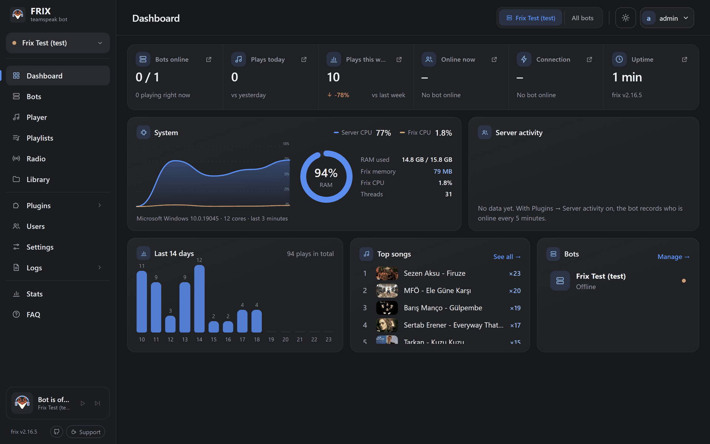
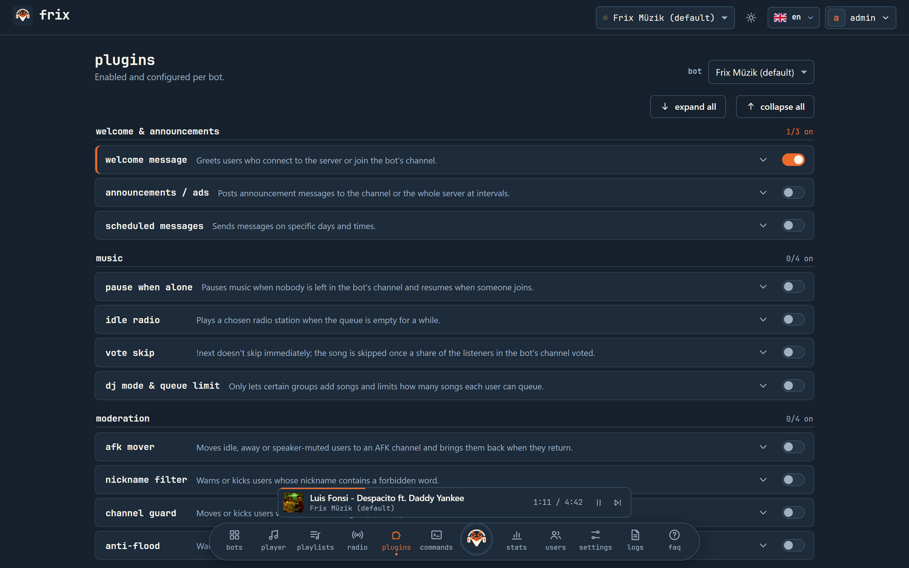
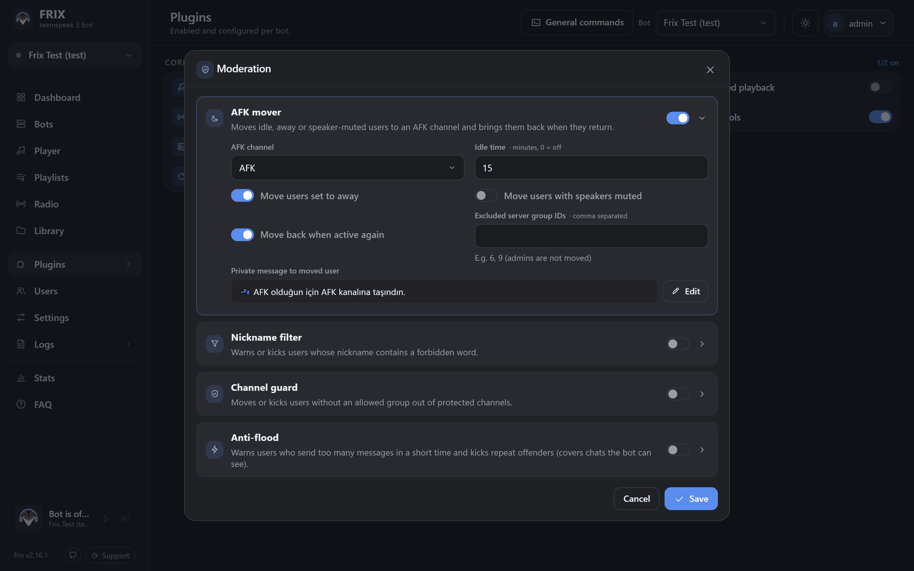
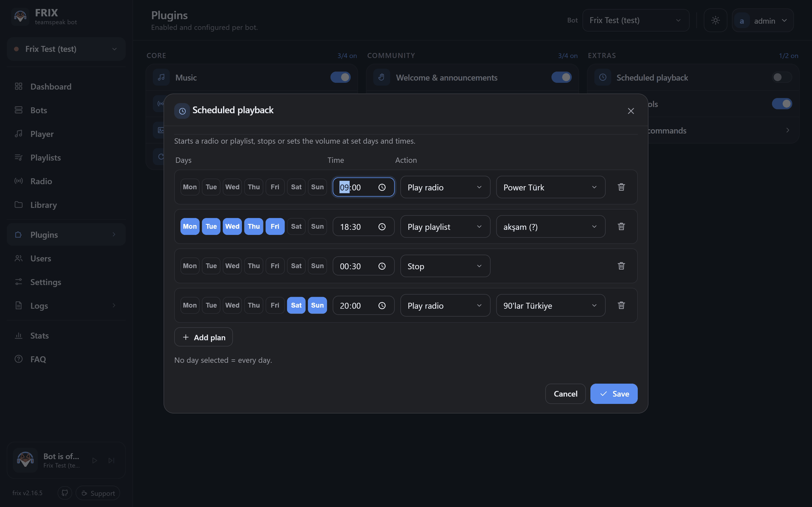
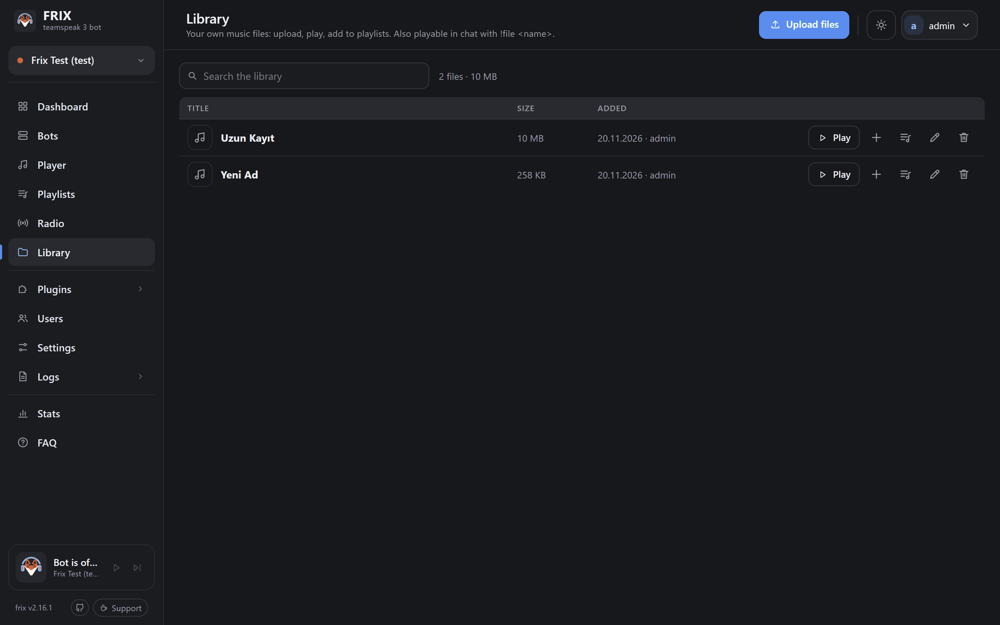
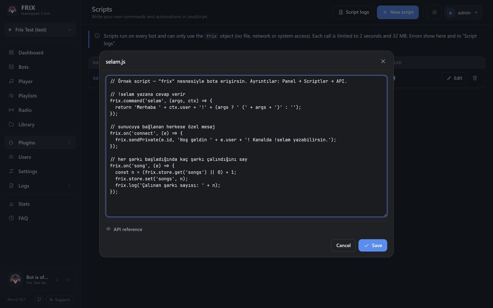
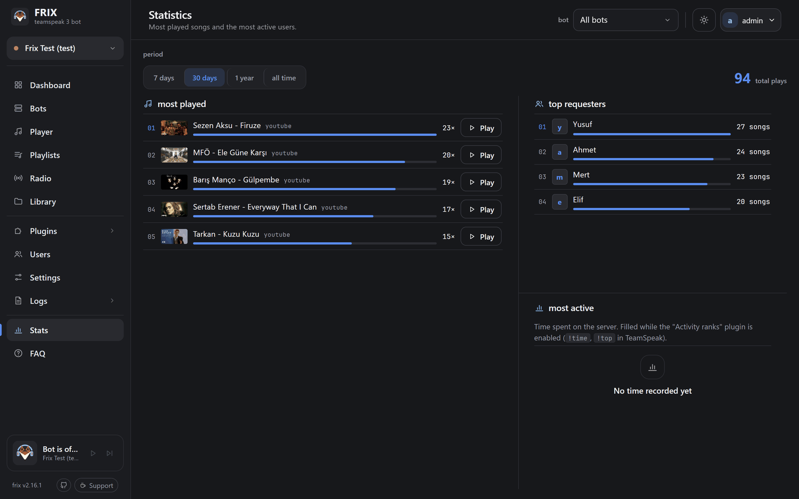
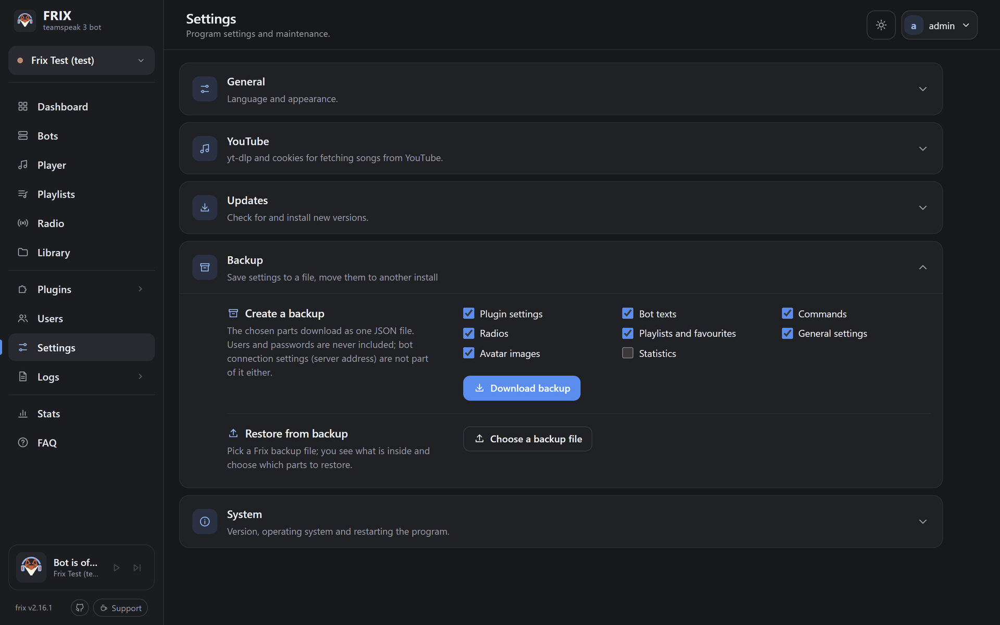
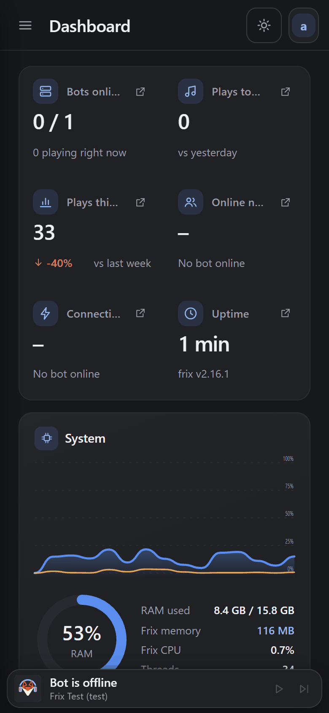

<div align="center">


# 🦊 Frix TeamSpeak Bot

**Music, moderation and server management for TeamSpeak 3 & 6 — one self-hosted bot with a modern web panel.**
Plays YouTube (incl. live streams), radios and your own files, keeps your server tidy, greets and ranks your users,
and runs your own JavaScript automations. No TeamSpeak client, VLC or virtual audio cable needed.

[Website](https://frix-teamspeak.github.io/) · [Docs](https://frix-teamspeak.github.io/docs.html) · [Türkçe](README.tr.md) · [FAQ](docs/FAQ.md) · [API](docs/API.md) · [Releases](https://github.com/lyusufdeniz/frix-teamspeak-bot/releases)

<a href="https://github.com/lyusufdeniz/frix-teamspeak-bot/releases/latest"></a>
<a href="https://github.com/lyusufdeniz/frix-teamspeak-bot/pkgs/container/frix"></a>
<a href="https://buymeacoffee.com/lyusufdeniz"></a>



</div>

---

Frix is built on top of the excellent open-source [TS3AudioBot](https://github.com/Splamy/TS3AudioBot) (OSL-3.0).
The bot connects to your TeamSpeak server by itself and streams audio directly with Opus, so it runs headless on
**Windows and Linux** servers, in **Docker** and on **Pterodactyl**.

## ✨ What Frix does

### 🎵 Music
- `!play <song or link>` – YouTube search, links, playlists and **live streams** (YouTube live, Twitch, …) via **yt-dlp → ffmpeg**, no downloads
- **Internet radio** managed in the panel (`.m3u`, `.pls`, `.xspf`, HLS `.m3u8` import), `!radio <name>`
- **Your own music library**: upload mp3 / ogg / flac / wav… in the panel, `!file <name>` in chat
- Playlists, favourites (`!fav`), autoplay of similar songs, volume levelling, vote skip, DJ mode and queue limits
- **Scheduled playback** with a visual planner (days, time, radio / playlist / stop / volume)
- The playing song as the bot's nickname / description (`{title}`, `{artist}`, `{song}`), per-state avatars (command card, song cover or your own image)

### 🛡️ Moderation & server management
- AFK mover, nickname filter, channel guard, anti-flood
- Registration bot (`!register`), temporary channel creator, support notifier
- Channel name info with live counters (`{online}`, `{record}`, `{time}`, …)
- `!come` to bring the bot to your channel, `!lastseen <name>`

### 👥 Community
- Welcome messages, rotating and scheduled announcements
- **Activity ranks**: time on the server → server groups, with a visual rank editor
- Server activity charts and busiest hours on the dashboard, who-is-online list, ping and packet loss
- Polls with live percentages, dice, coin flip, weather, currency, lyrics

### ⚙️ Automation
- **Scripts**: write your own commands and event handlers in JavaScript, sandboxed (`frix.command`, `frix.on('connect' | 'song' | …)`, `frix.store`)
- Custom commands (text replies or aliases), rename any built-in command
- Every bot reply editable with a **BBCode editor** and live preview, in 9 languages

### 🖥️ Web panel
- Dashboard: server CPU / RAM, plays, top songs, online users, connection quality of every bot
- 10 plugins with feature cards, enabled per bot; texts of disabled plugins are dimmed
- **Users & roles** (admin / DJ / viewer), live logs, audit log
- **Backup & restore**, one-click updates from GitHub, yt-dlp updater, YouTube cookie upload
- Dark (smoke grey + blue) and light theme, mobile friendly

**Security**
- PBKDF2-SHA256 password hashing, HttpOnly + SameSite=Strict session cookies, CSRF header check
- Login rate limiting (5 attempts → 10 min lock), strict Content-Security-Policy
- Remote first-time setup requires a one-time setup code shown on the server
- Everything stored in a local SQLite database (`frix.db`)

## 📸 Screenshots

| | |
|---|---|
|  |  |
| Plugins, enabled per bot | Every feature is a card with its own settings |
|  |  |
| Visual scheduled playback | Your own music library |
|  |  |
| JavaScript scripts | Statistics |
|  |  |
| Settings, backup & restore | Mobile view |

## 🚀 Installation

### Windows (Server / 10 / 11)
1. Download `Frix-win-x64.zip` from [Releases](../../releases) and extract it, e.g. to `C:\Frix`.
2. Run **`Frix.exe`**. The Frix fox icon appears in the system tray (no console window).
3. Open **http://localhost:58913** and create your admin account.
4. In the panel, go to **Bots → New bot**, enter your TeamSpeak address (e.g. `localhost:9987`) and start it.

The tray icon lets you open the panel, restart the bot, toggle "start with Windows" (enabled by default) and quit.
The bot is restarted automatically if it crashes.

> For an unattended server reboot without logging in, enable Windows auto-login (`netplwiz`).

### Linux (Debian/Ubuntu, Fedora, Arch, Alpine)
```bash
wget https://github.com/lyusufdeniz/frix-teamspeak-bot/releases/latest/download/Frix-linux-x64.zip
unzip Frix-linux-x64.zip && cd Frix-linux-x64
sudo bash install.sh
```
`install.sh` installs `ffmpeg` and `libopus`, creates the `frix` user, copies the bot to `/opt/frix`
and enables the `frix` systemd service. It prints the panel URL and the setup code.

```bash
systemctl status frix      # status
journalctl -u frix -f      # logs (also in the web panel)
sudo ufw allow 58913/tcp          # open the panel port if you use a firewall
```

### Docker
```bash
docker run -d --name frix --restart unless-stopped -p 58913:58913 -v frix-data:/data ghcr.io/lyusufdeniz/frix:latest
```
All data lives in the `frix-data` volume. A [`docker-compose.yml`](docker-compose.yml) is included. Images are published for `amd64` and `arm64`; use `FRIX_WEB_PORT` to change the panel port.

### Pterodactyl
Import [`packaging/pterodactyl/egg-frix.json`](packaging/pterodactyl/egg-frix.json) (Admin → Nests → Import Egg), create a server and open the panel on its primary port. Reinstalling the server updates Frix and keeps your data.

### Remote access
The panel listens on TCP **58913**. Open it in your firewall to use it from outside.
The connection is plain HTTP — for internet exposure put it behind a reverse proxy with HTTPS (Caddy, nginx, …).

## 💬 TeamSpeak commands

Command names are **English** in every language except Turkish; the Turkish names always keep working. Every name can be changed in the panel (Commands → built-in commands).

| Command | Turkish name | Description |
|---|---|---|
| `!play <song/link>` | `!ara` | Play or queue a song (YouTube search, any supported link) |
| `!radio [name]` | `!radyo` | Play a radio station / list stations |
| `!next` | `!gec` | Next song (or vote, with the vote-skip plugin) |
| `!pause / !resume` | `!dur / !devam` | Pause toggle / resume |
| `!stop` | `!bitir` | Stop and clear the queue |
| `!vol [0-100]` | `!ses` | Show / set volume |
| `!np` | `!calan` | Now playing |
| `!queue / !clear` | `!siradaki / !temizle` | Show / clear the queue |
| `!playlist [save\|play\|add\|show\|delete] <name>` | `!liste [kaydet\|cal\|ekle\|goster\|sil]` | Playlists |
| `!lyrics [song]` | `!soz` | Lyrics (private message) |
| `!poll Question \| a \| b, !vote <no>` | `!anket, !oy` | Poll |
| `!weather <city>, !fx <code> [amount], !usd, !eur` | `!hava, !doviz, !dolar, !euro` | Weather / currency |
| `!dice [2d6], !coin, !pick a \| b` | `!zar, !yazitura, !sec` | Dice, coin flip, pick |
| `!stats, !top, !time` | `!istatistik, !top, !sure` | Stats, most active users, your online time |
| `!register <name>` | `!kayit` | Register a user (staff, registration plugin) |
| `!file <name>` | `!dosya` | Play a file from the panel's music library |
| `!come` | `!gel` | Bring the bot to your channel |
| `!lastseen <name>` | `!gorulme` | When was someone last online |
| `!help` | `!yardim` | Help |

Bot replies are available in 9 languages (TR, EN, DE, ES, FR, RU, PT, PL, IT). Custom commands, command names and all reply texts can be changed in the panel.

## 🔄 Updating
- **Panel → Settings → Check for updates → Update now.** Your settings, database, bots and cookies are kept.
- yt-dlp (YouTube support) can be updated separately from the same page — do this whenever YouTube stops working.

## 🛠 Building from source
Requirements: .NET 10 SDK, git (with submodules), bash, curl, unzip.
```bash
git clone --recurse-submodules https://github.com/lyusufdeniz/frix-teamspeak-bot.git
cd frix-teamspeak-bot
./packaging/package.sh win-x64     # or linux-x64 / linux-arm64
```
The package appears in `dist/`. Pushing a tag like `v2.0.1` builds both packages and publishes a release via GitHub Actions.

| Path | |
|---|---|
| `TS3AudioBot/` | Bot (TS3AudioBot fork). Frix code: `Frix/`, `Web/Panel*.cs`, `MainCommands.Frix.cs`, `ResourceFactories/Ytdlp*.cs` |
| `FrixPanel/` | Web panel (vanilla JS SPA, no build step) |
| `FrixTray/` | Windows tray launcher, watchdog and updater |
| `packaging/` | Release packaging, Linux installer & systemd service |
| `docs/` | API reference, FAQ, original TS3AudioBot README |

## ❓ Problems?
See the [FAQ](docs/FAQ.md) (also available inside the panel).

## 📄 License
Open Software License 3.0 (OSL-3.0), same as the upstream [TS3AudioBot](https://github.com/Splamy/TS3AudioBot).
See [LICENSE](LICENSE). Frix is not affiliated with TeamSpeak Systems GmbH.

## ☕ Support

Frix is free and open source. If it is useful to you, you can support its development on [Buy Me a Coffee](https://buymeacoffee.com/lyusufdeniz).
