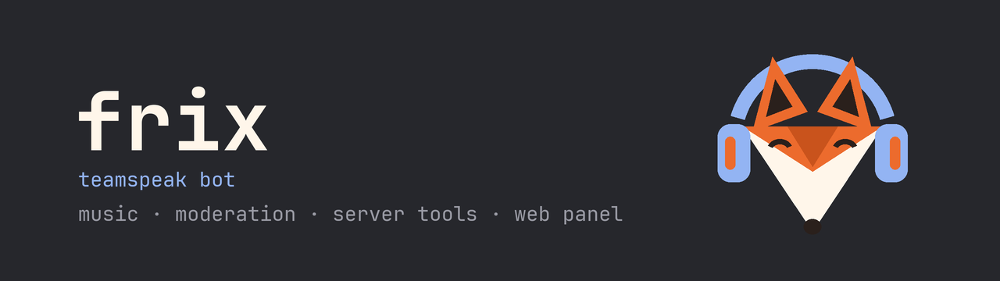
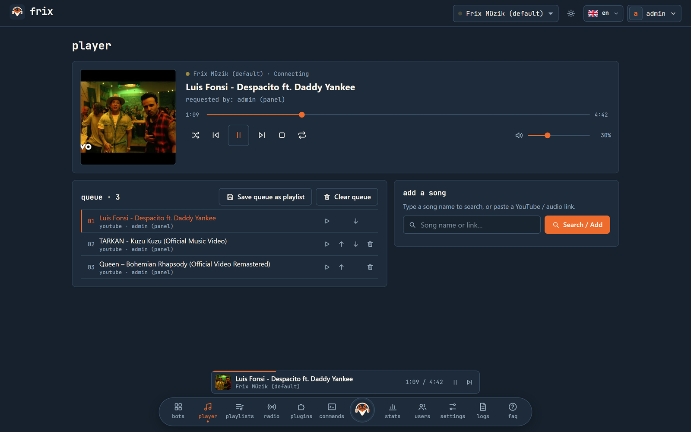
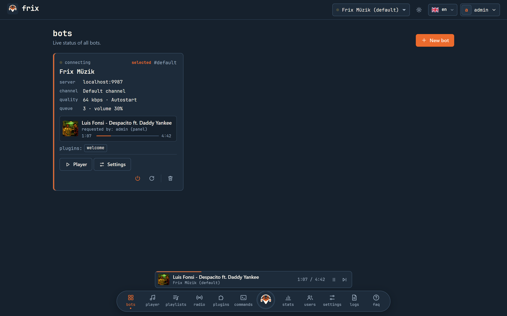
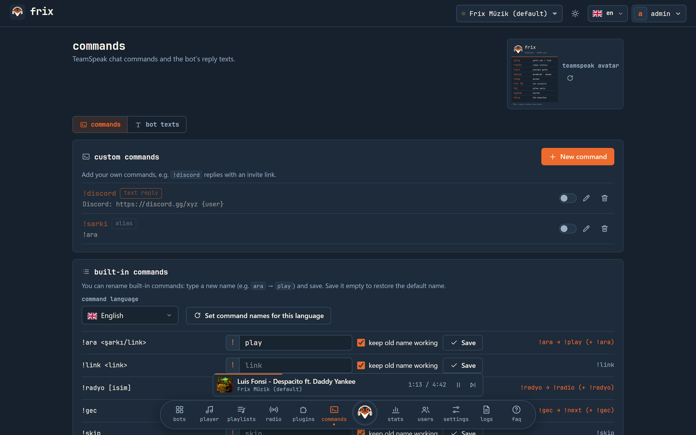
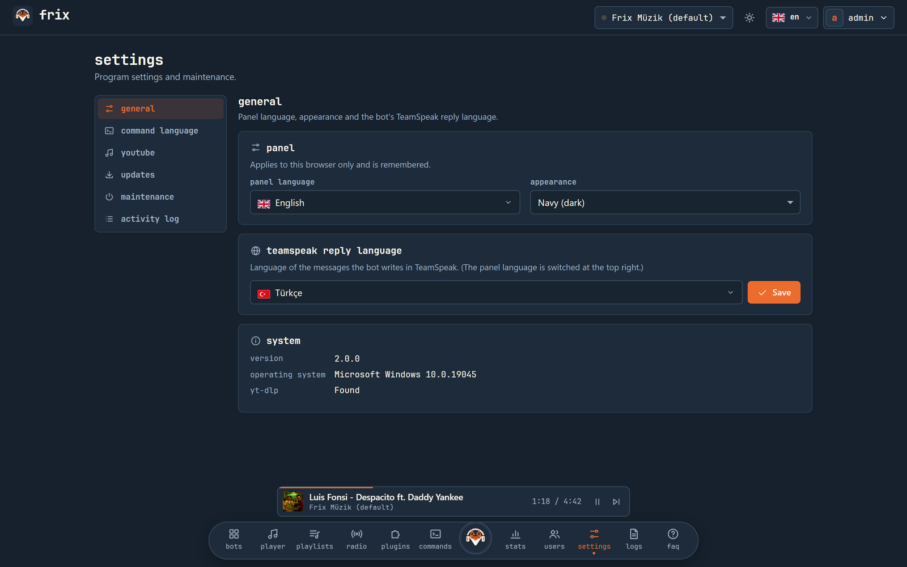
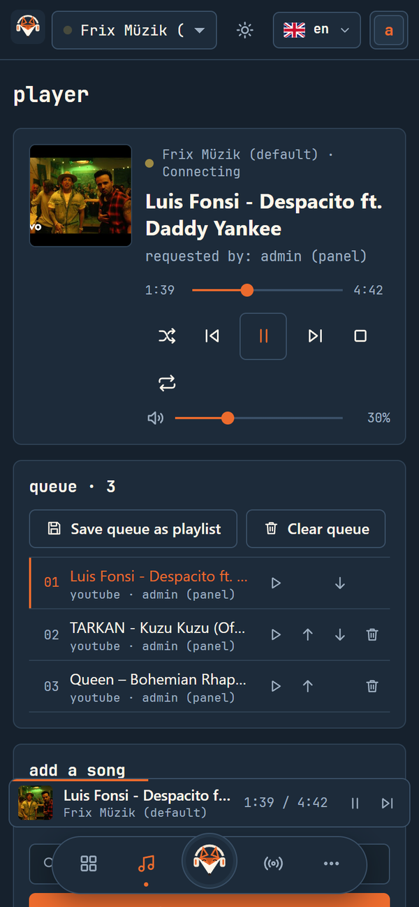

<div align="center">



# 🎵 Frix TeamSpeak 3 Bot

**A self-hosted TeamSpeak 3 music & utility bot with a modern web panel.**
Plays YouTube (incl. live streams), SoundCloud, Twitch, internet radio and more — no TeamSpeak client, VLC or virtual audio cable needed.

[Türkçe](README.tr.md) · [FAQ](docs/FAQ.md) · [API](docs/API.md)

</div>

---

Frix is built on top of the excellent open-source [TS3AudioBot](https://github.com/Splamy/TS3AudioBot) (OSL-3.0).
The bot connects to your TeamSpeak server by itself and streams audio directly with Opus, so it runs headless on
**Windows and Linux** servers.

## ✨ Features

**Music**
- `!ara <song or link>` – search YouTube and play / queue (multi-word search)
- Direct streaming through **yt-dlp → ffmpeg** (no downloads, starts in a few seconds)
- **Live streams** (YouTube live, Twitch, …) and **internet radio** (direct streams, `.m3u`, `.pls`, `.xspf`, HLS `.m3u8`)
- Radio stations managed in the panel, played with `!radyo <name>`
- Queue, skip, pause, seek, repeat, shuffle, volume
- Colored channel messages, "Now playing" announcements, editable reply texts (Turkish 🇹🇷 / English 🇬🇧)
- Idle avatar that shows the command list
- Channel commander mode

**Web panel** (single-page app, mobile friendly, TR/EN)
- First-run setup wizard (you choose the admin username & password)
- **Dashboard**: live server CPU / RAM chart, Frix memory usage, plays today / this week, top songs and requesters, and the status of **multiple bots**
- Left sidebar layout with a dark (charcoal + violet) and a light theme
- Player with search results, "adding song" progress, queue move/remove, seek, volume
- **22 plugins**, each enabled and configured per bot:
  - *Core:* music, radio (turn either off to disable its commands), song title as the bot's nickname/description, avatar (idle command card, song cover), auto reconnect (rejoins the same channel)
  - *Welcome & announcements:* welcome message, announcements/ads, scheduled messages
  - *Music:* pause when alone, idle radio, vote skip, DJ mode & queue limit
  - *Moderation:* AFK mover, nickname filter, channel guard, anti-flood
  - *Server management:* registration (`!kayit`), temporary channel creator, activity ranks, support notifier, channel name info
  - *Fun & tools:* polls, dice, coin flip, pick, weather, currency, lyrics
- **Playlists** (`!liste`) and **statistics** (most played songs, top requesters, most active users)
- Rename any built-in command, add custom commands; command names follow the language chosen at setup
- **Custom commands** (text replies or aliases) and editable bot replies with a **BBCode editor** (bold, italic, colours, live preview) and a default message colour
- The commands page only lists commands whose plugin is on
- **Users & roles**: admin / DJ / viewer
- Live logs, audit log, yt-dlp updater, YouTube cookie upload, **one-click updates from GitHub Releases**

**Security**
- PBKDF2-SHA256 password hashing, HttpOnly + SameSite=Strict session cookies, CSRF header check
- Login rate limiting (5 attempts → 10 min lock), strict Content-Security-Policy
- Remote first-time setup requires a one-time setup code shown on the server
- Everything stored in a local SQLite database (`frix.db`)

## 📸 Screenshots

| | |
|---|---|
|  |  |
| Player with queue and now playing | Bots dashboard |
|  |  |
| Plugins, grouped and collapsible | Commands: rename, custom commands, avatar preview |
|  |  |
| Statistics | Settings |

<p align="center"><br><sub>Mobile view</sub></p>

## 🚀 Installation

### Windows (Server / 10 / 11)
1. Download `Frix-win-x64.zip` from [Releases](../../releases) and extract it, e.g. to `C:\Frix`.
2. Run **`Frix.exe`**. A green note icon appears in the system tray (no console window).
3. Open **http://localhost:58913** and create your admin account.
4. In the panel, go to **Bots → New bot**, enter your TeamSpeak address (e.g. `localhost:9987`) and start it.

The tray icon lets you open the panel, restart the bot, toggle "start with Windows" (enabled by default) and quit.
The bot is restarted automatically if it crashes.

> For an unattended server reboot without logging in, enable Windows auto-login (`netplwiz`).

### Linux (Debian/Ubuntu, Fedora, Arch, Alpine)
```bash
wget https://github.com/lyusufdeniz/frix-teamspeak-3-bot/releases/latest/download/Frix-linux-x64.zip
unzip Frix-linux-x64.zip && cd Frix-linux-x64
sudo bash install.sh
```
`install.sh` installs `ffmpeg` and `libopus`, creates the `frix` user, copies the bot to `/opt/frix`
and enables the `frix` systemd service. It prints the panel URL and the setup code.

```bash
systemctl status frix      # status
journalctl -u frix -f      # logs (also in the web panel)
sudo ufw allow 58913/tcp          # open the panel port if you use a firewall
```

### Remote access
The panel listens on TCP **58913**. Open it in your firewall to use it from outside.
The connection is plain HTTP — for internet exposure put it behind a reverse proxy with HTTPS (Caddy, nginx, …).

## 💬 TeamSpeak commands

Command names are **English by default**. If you choose another language in the setup wizard, command names follow that language (e.g. `!spielen`, `!играть`); the Turkish names always keep working. Every name can be changed in the panel (Commands → built-in commands).

| Command | Turkish name | Description |
|---|---|---|
| `!play <song/link>` | `!ara` | Play or queue a song (YouTube search, any supported link) |
| `!radio [name]` | `!radyo` | Play a radio station / list stations |
| `!next` | `!gec` | Next song (or vote, with the vote-skip plugin) |
| `!pause / !resume` | `!dur / !devam` | Pause toggle / resume |
| `!stop` | `!bitir` | Stop and clear the queue |
| `!vol [0-100]` | `!ses` | Show / set volume |
| `!np` | `!calan` | Now playing |
| `!queue / !clear` | `!siradaki / !temizle` | Show / clear the queue |
| `!playlist [save\|play\|add\|show\|delete] <name>` | `!liste [kaydet\|cal\|ekle\|goster\|sil]` | Playlists |
| `!lyrics [song]` | `!soz` | Lyrics (private message) |
| `!poll Question \| a \| b, !vote <no>` | `!anket, !oy` | Poll |
| `!weather <city>, !fx <code> [amount], !usd, !eur` | `!hava, !doviz, !dolar, !euro` | Weather / currency |
| `!dice [2d6], !coin, !pick a \| b` | `!zar, !yazitura, !sec` | Dice, coin flip, pick |
| `!stats, !top, !time` | `!istatistik, !top, !sure` | Stats, most active users, your online time |
| `!register <name>` | `!kayit` | Register a user (staff, registration plugin) |
| `!help` | `!yardim` | Help |

Bot replies are available in 9 languages (TR, EN, DE, ES, FR, RU, PT, PL, IT). Custom commands, command names and all reply texts can be changed in the panel.

## 🔄 Updating
- **Panel → Settings → Check for updates → Update now.** Your settings, database, bots and cookies are kept.
- yt-dlp (YouTube support) can be updated separately from the same page — do this whenever YouTube stops working.

## 🛠 Building from source
Requirements: .NET 10 SDK, git (with submodules), bash, curl, unzip.
```bash
git clone --recurse-submodules https://github.com/lyusufdeniz/frix-teamspeak-3-bot.git
cd frix-teamspeak-3-bot
./packaging/package.sh win-x64     # or linux-x64 / linux-arm64
```
The package appears in `dist/`. Pushing a tag like `v2.0.1` builds both packages and publishes a release via GitHub Actions.

| Path | |
|---|---|
| `TS3AudioBot/` | Bot (TS3AudioBot fork). Frix code: `Frix/`, `Web/Panel*.cs`, `MainCommands.Frix.cs`, `ResourceFactories/Ytdlp*.cs` |
| `FrixPanel/` | Web panel (vanilla JS SPA, no build step) |
| `FrixTray/` | Windows tray launcher, watchdog and updater |
| `packaging/` | Release packaging, Linux installer & systemd service |
| `docs/` | API reference, FAQ, original TS3AudioBot README |

## ❓ Problems?
See the [FAQ](docs/FAQ.md) (also available inside the panel).

## 📄 License
Open Software License 3.0 (OSL-3.0), same as the upstream [TS3AudioBot](https://github.com/Splamy/TS3AudioBot).
See [LICENSE](LICENSE). Frix is not affiliated with TeamSpeak Systems GmbH.
