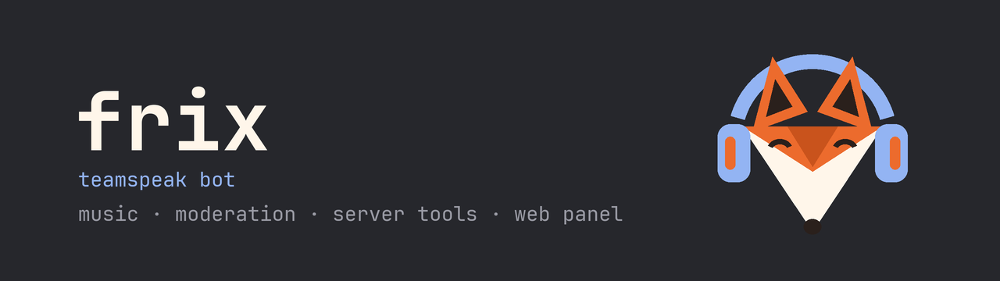
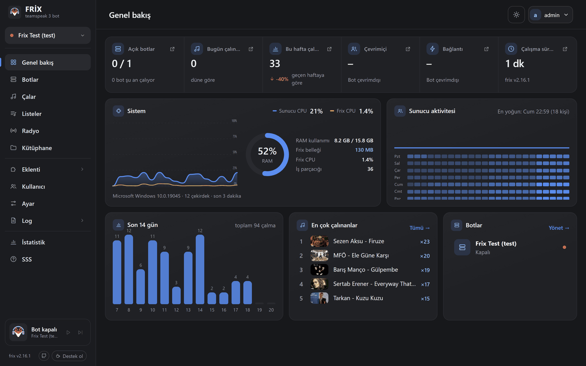
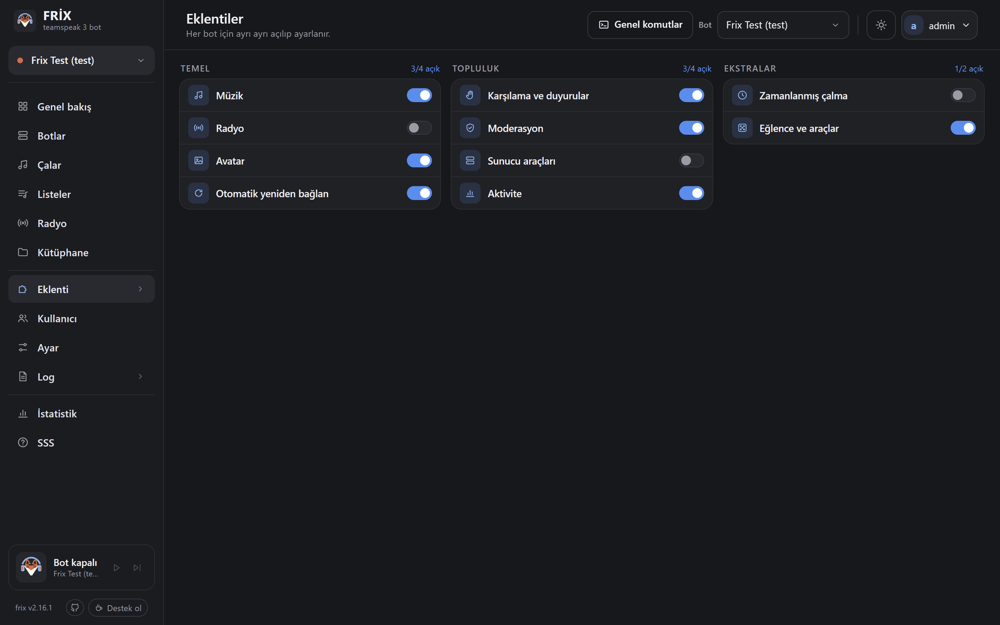
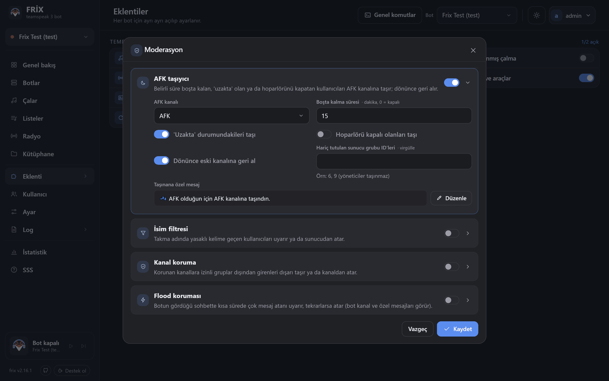
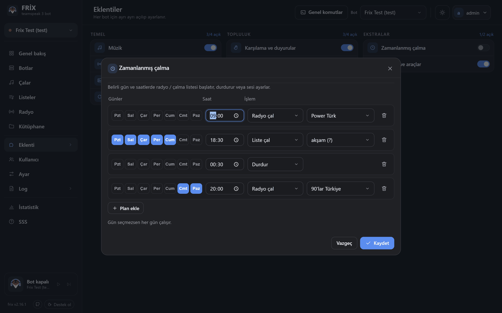
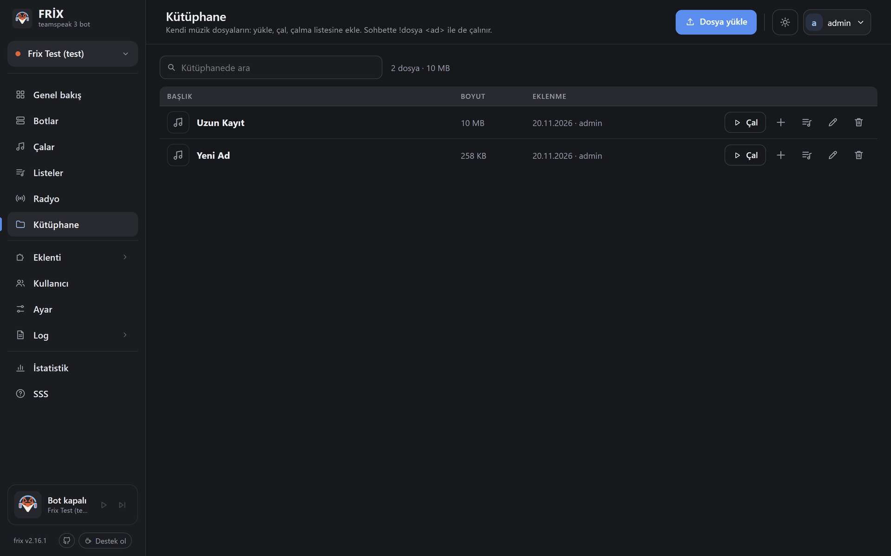
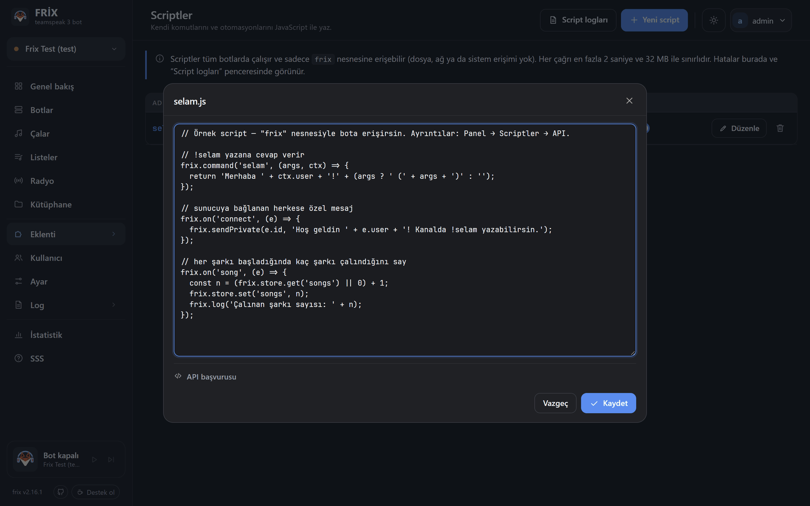
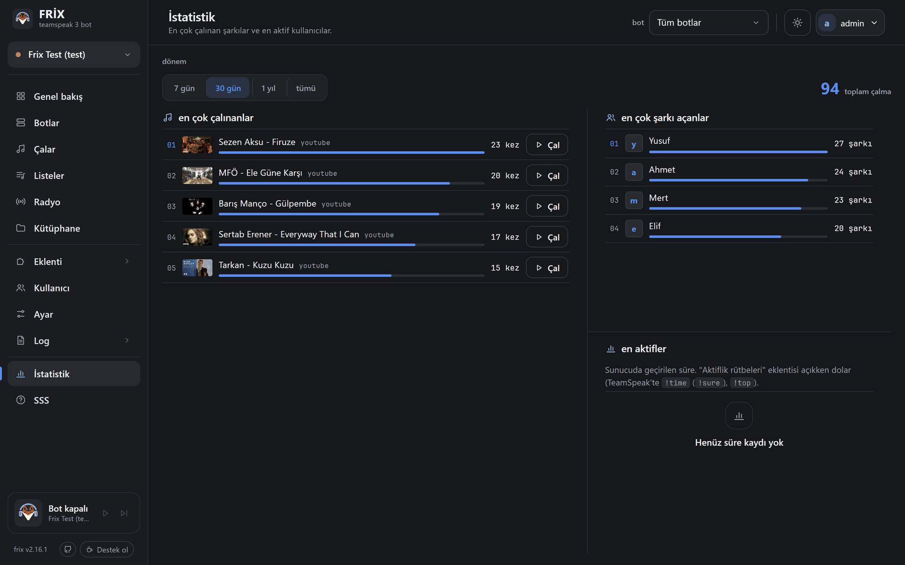
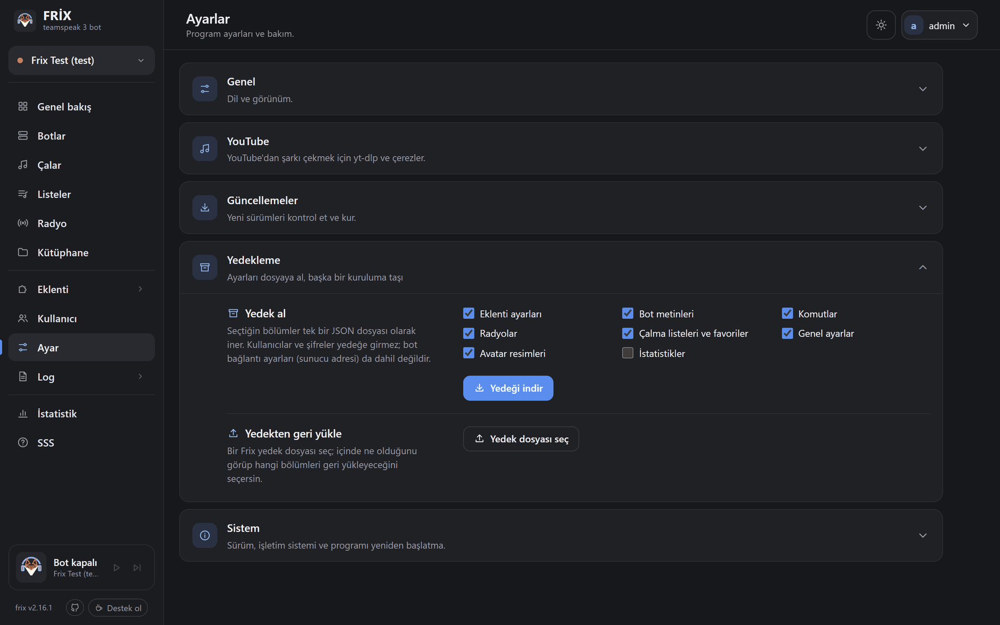
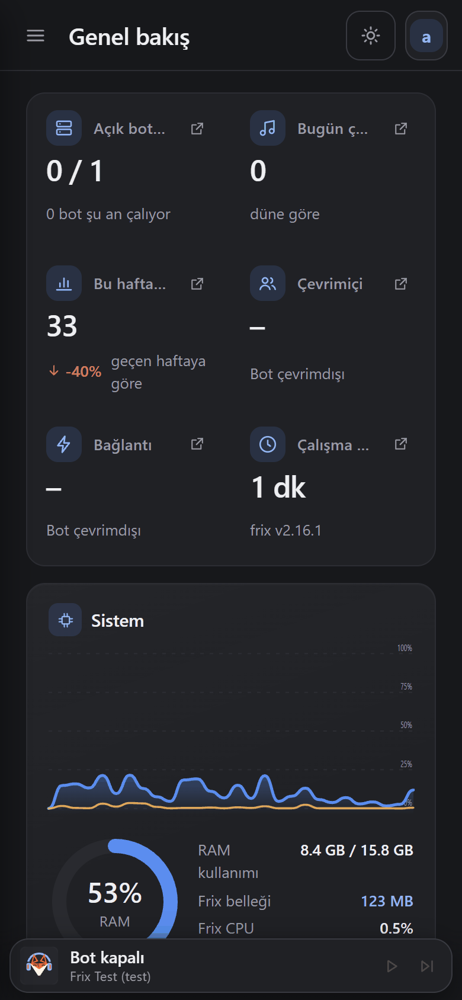

<div align="center">



# 🦊 Frix TeamSpeak 3 Bot

**TeamSpeak 3 için müzik, moderasyon ve sunucu yönetimi — modern web panelli, kendi sunucunda çalışan tek bot.**
YouTube (canlı yayınlar dahil), radyolar ve kendi dosyalarını çalar; sunucunu düzenli tutar, kullanıcılarını karşılar
ve rütbe verir, kendi JavaScript otomasyonlarını çalıştırır. TeamSpeak istemcisi, VLC ya da sanal ses kablosu gerekmez.

[English](README.md) · [SSS](docs/FAQ.md) · [API](docs/API.md) · [Sürümler](https://github.com/lyusufdeniz/frix-teamspeak-3-bot/releases)

<a href="https://github.com/lyusufdeniz/frix-teamspeak-3-bot/releases/latest"></a>
<a href="https://github.com/lyusufdeniz/frix-teamspeak-3-bot/pkgs/container/frix"></a>
<a href="https://buymeacoffee.com/lyusufdeniz"></a>



</div>

---

Frix, açık kaynaklı [TS3AudioBot](https://github.com/Splamy/TS3AudioBot) (OSL-3.0) üzerine kurulmuştur.
Bot TeamSpeak sunucusuna kendisi bağlanır ve sesi doğrudan Opus ile gönderir; bu sayede **Windows ve Linux**
sunucularda ekransız, **Docker**'da ve **Pterodactyl**'de çalışır.

## ✨ Frix neler yapar

### 🎵 Müzik
- `!ara <şarkı ya da link>` – YouTube araması, linkler, oynatma listeleri ve **canlı yayınlar** (YouTube canlı, Twitch…); **yt-dlp → ffmpeg** ile indirmeden çalar
- Panelden yönetilen **internet radyoları** (`.m3u`, `.pls`, `.xspf`, HLS `.m3u8` içe aktarma), `!radyo <isim>`
- **Kendi müzik kütüphanen**: panelden mp3 / ogg / flac / wav… yükle, sohbette `!dosya <ad>`
- Çalma listeleri, favoriler (`!fav`), benzer şarkılarla otomatik devam, ses eşitleme, oylamayla geç, DJ modu ve kuyruk limiti
- Görsel planlayıcıyla **zamanlanmış çalma** (gün, saat, radyo / liste / durdur / ses)
- Çalan şarkı botun adı / açıklaması olur (`{title}`, `{artist}`, `{song}`); durum başına avatar (komut kartı, şarkı kapağı ya da kendi resmin)

### 🛡️ Moderasyon ve sunucu yönetimi
- AFK taşıyıcı, isim filtresi, kanal koruma, flood koruması
- Kayıt botu (`!kayit`), geçici kanal oluşturucu, destek bildirimi
- Canlı sayaçlı kanal adı (`{online}`, `{record}`, `{time}`…)
- Botu kanalına çağırma `!gel`, son görülme `!gorulme <isim>`

### 👥 Topluluk
- Karşılama mesajları, dönen ve zamanlı duyurular
- **Aktiflik rütbeleri**: sunucuda geçen süreye göre grup verme, görsel rütbe düzenleyici
- Dashboard'da sunucu aktivitesi grafikleri ve en yoğun saatler, çevrimiçi listesi, ping ve paket kaybı
- Canlı yüzdeli anketler, zar, yazı-tura, hava durumu, döviz, şarkı sözleri

### ⚙️ Otomasyon
- **Scriptler**: kendi komutlarını ve olay dinleyicilerini JavaScript ile yaz, korumalı alanda çalışır (`frix.command`, `frix.on('connect' | 'song' | …)`, `frix.store`)
- Özel komutlar (metin cevabı ya da yönlendirme), her yerleşik komutu yeniden adlandırma
- Botun tüm cevapları canlı önizlemeli **BBCode editörüyle** düzenlenir, 9 dil

### 🖥️ Web panel
- Genel bakış: sunucu CPU / RAM, çalınanlar, en çok çalınanlar, çevrimiçi kişiler, her botun bağlantı kalitesi
- Her bot için ayrı açılan, özellik kartlı 10 eklenti; kapalı eklentilerin metinleri soluk görünür
- **Kullanıcılar ve roller** (yönetici / DJ / izleyici), canlı loglar, işlem kaydı
- **Yedek alma / geri yükleme**, GitHub'dan tek tıkla güncelleme, yt-dlp güncelleme, YouTube çerez yükleme
- Koyu (füme + mavi) ve açık tema, mobil uyumlu

**Güvenlik**
- PBKDF2-SHA256 şifre hash'leme, HttpOnly + SameSite=Strict oturum çerezi, CSRF başlık kontrolü
- Giriş deneme sınırı (5 hatalı deneme → 10 dk kilit), sıkı Content-Security-Policy
- Uzaktan ilk kurulum için sunucuda gösterilen tek kullanımlık kurulum kodu gerekir
- Tüm veriler yerel SQLite veritabanında (`frix.db`)

## 📸 Ekran görüntüleri

| | |
|---|---|
|  |  |
| Her bot için ayrı açılan eklentiler | Her özellik kendi ayarlarıyla bir kart |
|  |  |
| Görsel zamanlanmış çalma | Kendi müzik kütüphanen |
|  |  |
| JavaScript scriptleri | İstatistikler |
|  |  |
| Ayarlar, yedek alma ve geri yükleme | Mobil görünüm |

## 🚀 Kurulum

### Windows (Server / 10 / 11)
1. [Releases](../../releases) sayfasından `Frix-win-x64.zip` dosyasını indir ve örneğin `C:\Frix` klasörüne çıkar.
2. **`Frix.exe`** dosyasını çalıştır. Saatin yanında yeşil nota simgesi çıkar (konsol penceresi açılmaz).
3. **http://localhost:58913** adresini aç ve yönetici hesabını oluştur.
4. Panelde **Botlar → Yeni bot** ile TeamSpeak adresini gir (ör. `localhost:9987`) ve botu başlat.

Tray simgesinden paneli açabilir, botu yeniden başlatabilir, "Windows açılışında başlat"ı (varsayılan açık) yönetebilir ve çıkabilirsin.
Bot çökerse otomatik yeniden açılır.

> Sunucu yeniden başladığında kimse giriş yapmasa da bot açılsın istiyorsan Windows otomatik oturum açmayı etkinleştir (`netplwiz`).

### Linux (Debian/Ubuntu, Fedora, Arch, Alpine)
```bash
wget https://github.com/lyusufdeniz/frix-teamspeak-3-bot/releases/latest/download/Frix-linux-x64.zip
unzip Frix-linux-x64.zip && cd Frix-linux-x64
sudo bash install.sh
```
`install.sh`; `ffmpeg` ve `libopus` kurar, `frix` kullanıcısını oluşturur, botu `/opt/frix` altına kopyalar
ve `frix` systemd servisini açar. Sonunda panel adresini ve kurulum kodunu yazar.

```bash
systemctl status frix      # durum
journalctl -u frix -f      # loglar (web panelde de var)
sudo ufw allow 58913/tcp          # güvenlik duvarı varsa panel portunu aç
```

### Docker
```bash
docker run -d --name frix --restart unless-stopped -p 58913:58913 -v frix-data:/data ghcr.io/lyusufdeniz/frix:latest
```
Tüm veriler `frix-data` biriminde durur. Hazır bir [`docker-compose.yml`](docker-compose.yml) da var. İmajlar `amd64` ve `arm64` için yayınlanır; panel portunu `FRIX_WEB_PORT` ile değiştirebilirsin.

### Pterodactyl
[`packaging/pterodactyl/egg-frix.json`](packaging/pterodactyl/egg-frix.json) dosyasını içe aktar (Admin → Nests → Import Egg), sunucu oluştur ve paneli sunucunun ana portunda aç. Sunucuyu yeniden kurmak Frix'i günceller, verilerin kalır.

### Dışarıdan erişim
Panel **TCP 58913** portunu dinler. Dışarıdan kullanmak için güvenlik duvarında bu portu aç.
Bağlantı düz HTTP'dir; internete açacaksan HTTPS'li bir ters vekil (Caddy, nginx…) arkasına koy.

## 💬 TeamSpeak komutları

Komut adları **varsayılan olarak İngilizcedir**. Kurulum sihirbazında Türkçe seçersen Türkçe adlar (`!ara`, `!gec`…) kullanılır; başka bir dil seçersen o dilin adları gelir. Türkçe adlar her durumda çalışır. Her ad panelden değiştirilebilir (Komutlar → yerleşik komutlar).

| Komut (İngilizce) | Türkçe adı | Açıklama |
|---|---|---|
| `!play <song/link>` | `!ara` | Şarkı çalar ya da kuyruğa ekler (YouTube arama, desteklenen her link) |
| `!radio [name]` | `!radyo` | Radyo çalar / radyoları listeler |
| `!next` | `!gec` | Sonraki şarkı (oylamayla geç eklentisinde oy verir) |
| `!pause / !resume` | `!dur / !devam` | Duraklat-devam / devam |
| `!stop` | `!bitir` | Durdurur ve kuyruğu siler |
| `!vol [0-100]` | `!ses` | Ses seviyesini gösterir / ayarlar |
| `!np` | `!calan` | Çalan şarkı |
| `!queue / !clear` | `!siradaki / !temizle` | Kuyruğu gösterir / boşaltır |
| `!playlist [save\|play\|add\|show\|delete] <name>` | `!liste [kaydet\|cal\|ekle\|goster\|sil]` | Çalma listeleri |
| `!lyrics [song]` | `!soz` | Şarkı sözleri (özel mesajla) |
| `!poll Question \| a \| b, !vote <no>` | `!anket, !oy` | Anket |
| `!weather <city>, !fx <code> [amount], !usd, !eur` | `!hava, !doviz, !dolar, !euro` | Hava durumu / döviz |
| `!dice [2d6], !coin, !pick a \| b` | `!zar, !yazitura, !sec` | Zar, yazı-tura, seçim |
| `!stats, !top, !time` | `!istatistik, !top, !sure` | İstatistik, en aktifler, kendi süren |
| `!register <name>` | `!kayit` | Kullanıcı kaydı (yetkili, kayıt eklentisi) |
| `!file <name>` | `!dosya` | Panel kütüphanesinden dosya çalar |
| `!come` | `!gel` | Botu kanalına çağırır |
| `!lastseen <name>` | `!gorulme` | Biri en son ne zaman çevrimiçiydi |
| `!help` | `!yardim` | Yardım |

Bot cevapları 9 dilde (TR, EN, DE, ES, FR, RU, PT, PL, IT). Özel komutlar, komut adları ve tüm cevap metinleri panelden değiştirilebilir.

## 🔄 Güncelleme
- **Panel → Ayarlar → Güncellemeleri denetle → Şimdi güncelle.** Ayarların, veritabanın, botların ve çerezlerin korunur.
- yt-dlp (YouTube desteği) aynı sayfadan ayrıca güncellenebilir; YouTube çalmayı bırakırsa bunu yap.

## 🛠 Kaynaktan derleme
Gerekenler: .NET 10 SDK, git (alt modüllerle), bash, curl, unzip.
```bash
git clone --recurse-submodules https://github.com/lyusufdeniz/frix-teamspeak-3-bot.git
cd frix-teamspeak-3-bot
./packaging/package.sh win-x64     # ya da linux-x64 / linux-arm64
```
Paket `dist/` klasöründe oluşur. `v2.0.1` gibi bir etiket gönderildiğinde GitHub Actions iki paketi de derleyip sürüm yayınlar.

## ❓ Sorun mu var?
[SSS](docs/FAQ.md) sayfasına bak (panelin içinde de var).

## 📄 Lisans
Open Software License 3.0 (OSL-3.0), [TS3AudioBot](https://github.com/Splamy/TS3AudioBot) ile aynı. Ayrıntılar: [LICENSE](LICENSE).
Frix'in TeamSpeak Systems GmbH ile bir bağlantısı yoktur.

## ☕ Destek

Frix ücretsiz ve açık kaynaktır. İşine yaradıysa geliştirilmesine [Buy Me a Coffee](https://buymeacoffee.com/lyusufdeniz) üzerinden destek olabilirsin.
