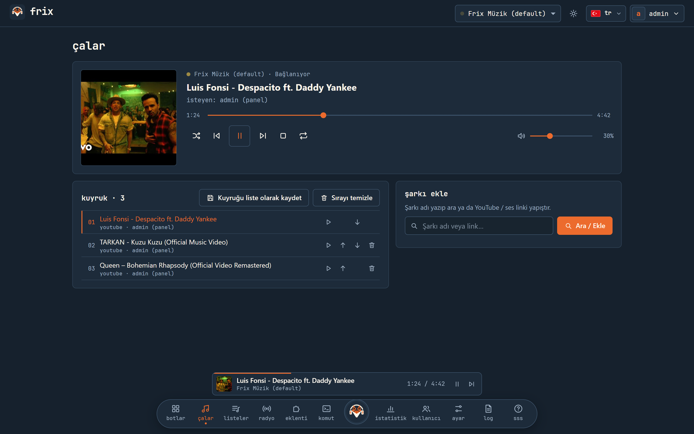
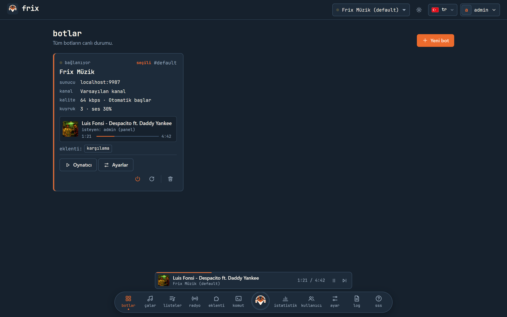
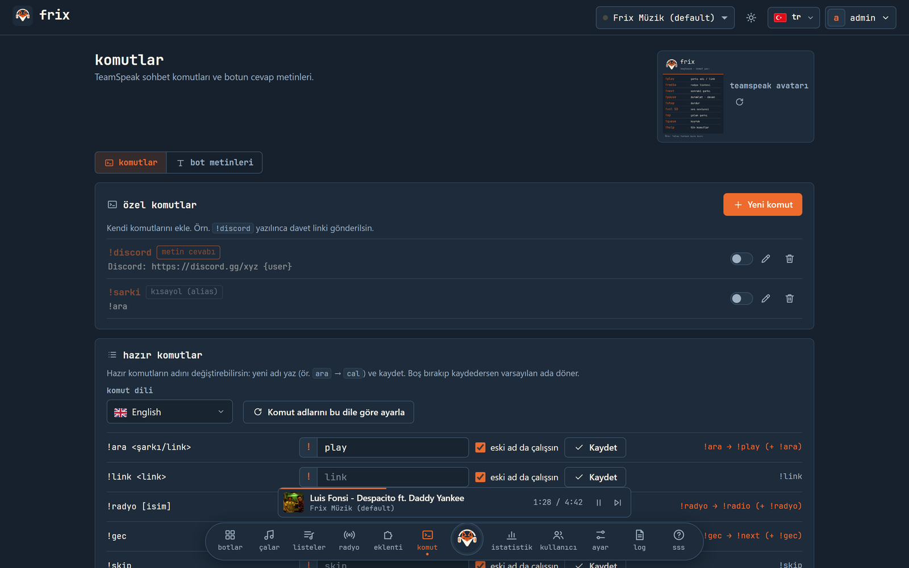
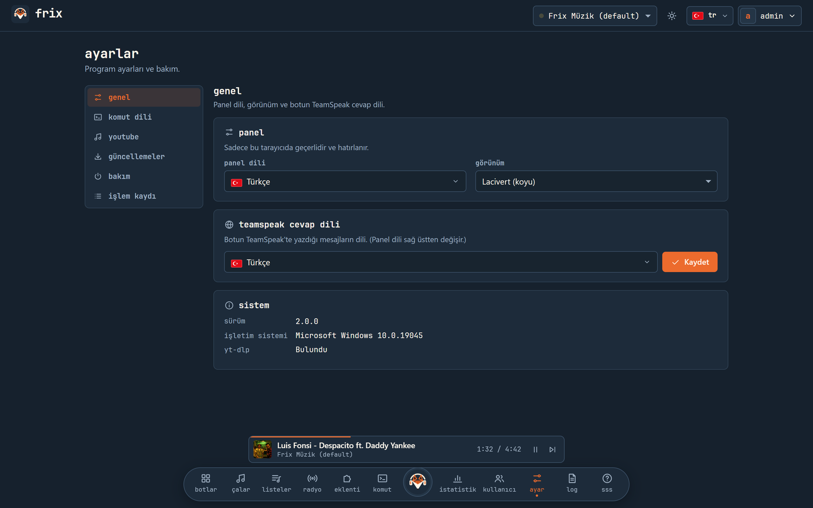
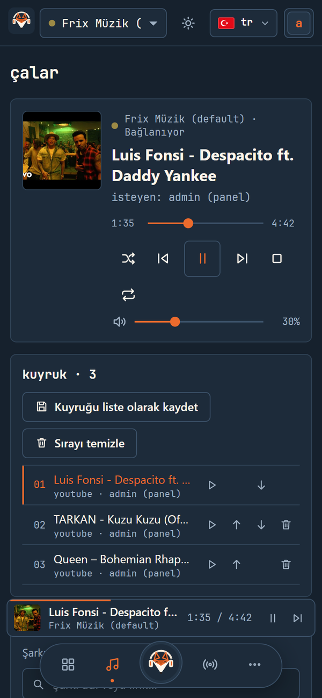

<div align="center">


# 🎵 Frix TeamSpeak 3 Bot

**Modern web panelli, kendi sunucunda çalışan TeamSpeak 3 müzik ve yardımcı botu.**
YouTube (canlı yayınlar dahil), SoundCloud, Twitch, internet radyoları ve daha fazlasını çalar — TeamSpeak istemcisi, VLC ya da sanal ses kablosu gerekmez.

[English](README.md) · [SSS](docs/FAQ.md) · [API](docs/API.md)

<a href="https://buymeacoffee.com/lyusufdeniz"></a>

</div>

---

Frix, açık kaynaklı [TS3AudioBot](https://github.com/Splamy/TS3AudioBot) (OSL-3.0) üzerine kurulmuştur.
Bot TeamSpeak sunucusuna kendisi bağlanır ve sesi doğrudan Opus ile gönderir; bu sayede **Windows ve Linux**
sunucularda ekransız çalışır.

## ✨ Özellikler

**Müzik**
- `!ara <şarkı ya da link>` – YouTube'da arar, çalar ya da kuyruğa ekler (çok kelimeli arama)
- **yt-dlp → ffmpeg** ile doğrudan akış (indirme yok, birkaç saniyede başlar)
- **Canlı yayınlar** (YouTube canlı, Twitch…) ve **internet radyoları** (doğrudan yayın, `.m3u`, `.pls`, `.xspf`, HLS `.m3u8`)
- Panelden eklenen radyolar `!radyo <isim>` ile çalınır
- Kuyruk, geç, duraklat, sar, tekrar, karışık, ses
- Renkli kanal mesajları, "Şimdi çalıyor" bildirimleri, düzenlenebilir cevap metinleri (Türkçe 🇹🇷 / İngilizce 🇬🇧)
- Boştayken komut listesini gösteren avatar, çalarken kapak resmi
- Channel commander (kanal komutanı) modu

**Web panel** (tek sayfa uygulama, mobil uyumlu, TR/EN)
- İlk kurulum sihirbazı (yönetici kullanıcı adını ve şifreyi sen belirlersin)
- **Genel bakış (dashboard)**: canlı sunucu CPU / RAM grafiği, Frix'in bellek kullanımı, bugün / bu hafta çalınanlar, en çok çalınanlar ve **birden fazla botun** durumu
- Sol menülü düzen; koyu (füme + mavi) ve açık tema
- Arama sonuçları, "şarkı ekleniyor" ilerleme çubuğu, kuyruk taşıma/silme, sarma, ses ayarlı oynatıcı
- Her bot için ayrı açılan **10 eklenti**; benzer özellikler tek eklentinin içinde, her biri ayrı açılıp kapanır:
  - *Müzik:* komutlar, ses seviyesi eşitleme, otomatik devam (kuyruk bitince benzer şarkılar), favoriler (`!fav`, `!favs`), oylamayla geç, DJ yetkisi ve kuyruk limiti, yalnızken duraklat, çalan şarkıyı bot adı/açıklaması yapma
  - *Radyo:* panelden eklenen radyolar (`!radyo`), boştayken radyo
  - *Avatar:* boşta, müzik ve radyo için ayrı avatar: komut kartı, şarkı kapağı ya da yüklediğin resim
  - *Otomatik yeniden bağlan:* düşünce aynı kanala geri girer
  - *Karşılama ve duyurular:* karşılama mesajı, dönen duyurular ve zamanlı duyurular
  - *Zamanlanmış çalma:* belirli saatlerde radyo/liste başlatma, durdurma, ses ayarı
  - *Moderasyon:* AFK taşıyıcı, isim filtresi, kanal koruma, flood koruması
  - *Sunucu araçları:* kayıt botu (`!kayit`), geçici kanal oluşturucu, kanal adında bilgi, destek bildirimi
  - *Aktivite:* dashboard'da çevrimiçi grafiği ve en yoğun saatler, aktiflik rütbeleri
  - *Eğlence ve araçlar:* anket, zar, yazı-tura, seçim, hava durumu, döviz, şarkı sözleri
- **Çalma listeleri** (`!liste`) ve **istatistikler** (en çok çalınanlar, en çok şarkı açanlar, en aktifler)
- Yerleşik komutlar yeniden adlandırılabilir, özel komut eklenebilir; komut adları kurulumda seçilen dile göre ayarlanır
- **Özel komutlar** (metin cevabı ya da yönlendirme) ve düzenlenebilir bot cevapları
- **Kullanıcılar ve roller**: yönetici / DJ / izleyici
- Canlı loglar, işlem kaydı, yt-dlp güncelleme, YouTube çerez yükleme, **GitHub'dan tek tıkla güncelleme**

**Güvenlik**
- PBKDF2-SHA256 şifre hash'leme, HttpOnly + SameSite=Strict oturum çerezi, CSRF başlık kontrolü
- Giriş deneme sınırı (5 hatalı deneme → 10 dk kilit), sıkı Content-Security-Policy
- Uzaktan ilk kurulum için sunucuda gösterilen tek kullanımlık kurulum kodu gerekir
- Tüm veriler yerel SQLite veritabanında (`frix.db`)

## 📸 Ekran görüntüleri

| | |
|---|---|
|  |  |
| Oynatıcı, kuyruk ve çalan şarkı | Botlar |
|  |  |
| Eklentiler (gruplu, açılır kapanır) | Komutlar: yeniden adlandırma, özel komutlar, avatar önizleme |
|  |  |
| İstatistikler | Ayarlar |

<p align="center"><br><sub>Mobil görünüm</sub></p>

## 🚀 Kurulum

### Windows (Server / 10 / 11)
1. [Releases](../../releases) sayfasından `Frix-win-x64.zip` dosyasını indir ve örneğin `C:\Frix` klasörüne çıkar.
2. **`Frix.exe`** dosyasını çalıştır. Saatin yanında yeşil nota simgesi çıkar (konsol penceresi açılmaz).
3. **http://localhost:58913** adresini aç ve yönetici hesabını oluştur.
4. Panelde **Botlar → Yeni bot** ile TeamSpeak adresini gir (ör. `localhost:9987`) ve botu başlat.

Tray simgesinden paneli açabilir, botu yeniden başlatabilir, "Windows açılışında başlat"ı (varsayılan açık) yönetebilir ve çıkabilirsin.
Bot çökerse otomatik yeniden açılır.

> Sunucu yeniden başladığında kimse giriş yapmasa da bot açılsın istiyorsan Windows otomatik oturum açmayı etkinleştir (`netplwiz`).

### Linux (Debian/Ubuntu, Fedora, Arch, Alpine)
```bash
wget https://github.com/lyusufdeniz/frix-teamspeak-3-bot/releases/latest/download/Frix-linux-x64.zip
unzip Frix-linux-x64.zip && cd Frix-linux-x64
sudo bash install.sh
```
`install.sh`; `ffmpeg` ve `libopus` kurar, `frix` kullanıcısını oluşturur, botu `/opt/frix` altına kopyalar
ve `frix` systemd servisini açar. Sonunda panel adresini ve kurulum kodunu yazar.

```bash
systemctl status frix      # durum
journalctl -u frix -f      # loglar (web panelde de var)
sudo ufw allow 58913/tcp          # güvenlik duvarı varsa panel portunu aç
```

### Dışarıdan erişim
Panel **TCP 58913** portunu dinler. Dışarıdan kullanmak için güvenlik duvarında bu portu aç.
Bağlantı düz HTTP'dir; internete açacaksan HTTPS'li bir ters vekil (Caddy, nginx…) arkasına koy.

## 💬 TeamSpeak komutları

Komut adları **varsayılan olarak İngilizcedir**. Kurulum sihirbazında Türkçe seçersen Türkçe adlar (`!ara`, `!gec`…) kullanılır; başka bir dil seçersen o dilin adları gelir. Türkçe adlar her durumda çalışır. Her ad panelden değiştirilebilir (Komutlar → yerleşik komutlar).

| Komut (İngilizce) | Türkçe adı | Açıklama |
|---|---|---|
| `!play <song/link>` | `!ara` | Şarkı çalar ya da kuyruğa ekler (YouTube arama, desteklenen her link) |
| `!radio [name]` | `!radyo` | Radyo çalar / radyoları listeler |
| `!next` | `!gec` | Sonraki şarkı (oylamayla geç eklentisinde oy verir) |
| `!pause / !resume` | `!dur / !devam` | Duraklat-devam / devam |
| `!stop` | `!bitir` | Durdurur ve kuyruğu siler |
| `!vol [0-100]` | `!ses` | Ses seviyesini gösterir / ayarlar |
| `!np` | `!calan` | Çalan şarkı |
| `!queue / !clear` | `!siradaki / !temizle` | Kuyruğu gösterir / boşaltır |
| `!playlist [save\|play\|add\|show\|delete] <name>` | `!liste [kaydet\|cal\|ekle\|goster\|sil]` | Çalma listeleri |
| `!lyrics [song]` | `!soz` | Şarkı sözleri (özel mesajla) |
| `!poll Question \| a \| b, !vote <no>` | `!anket, !oy` | Anket |
| `!weather <city>, !fx <code> [amount], !usd, !eur` | `!hava, !doviz, !dolar, !euro` | Hava durumu / döviz |
| `!dice [2d6], !coin, !pick a \| b` | `!zar, !yazitura, !sec` | Zar, yazı-tura, seçim |
| `!stats, !top, !time` | `!istatistik, !top, !sure` | İstatistik, en aktifler, kendi süren |
| `!register <name>` | `!kayit` | Kullanıcı kaydı (yetkili, kayıt eklentisi) |
| `!help` | `!yardim` | Yardım |

Bot cevapları 9 dilde (TR, EN, DE, ES, FR, RU, PT, PL, IT). Özel komutlar, komut adları ve tüm cevap metinleri panelden değiştirilebilir.

## 🔄 Güncelleme
- **Panel → Ayarlar → Güncellemeleri denetle → Şimdi güncelle.** Ayarların, veritabanın, botların ve çerezlerin korunur.
- yt-dlp (YouTube desteği) aynı sayfadan ayrıca güncellenebilir; YouTube çalmayı bırakırsa bunu yap.

## 🛠 Kaynaktan derleme
Gerekenler: .NET 10 SDK, git (alt modüllerle), bash, curl, unzip.
```bash
git clone --recurse-submodules https://github.com/lyusufdeniz/frix-teamspeak-3-bot.git
cd frix-teamspeak-3-bot
./packaging/package.sh win-x64     # ya da linux-x64 / linux-arm64
```
Paket `dist/` klasöründe oluşur. `v2.0.1` gibi bir etiket gönderildiğinde GitHub Actions iki paketi de derleyip sürüm yayınlar.

## ❓ Sorun mu var?
[SSS](docs/FAQ.md) sayfasına bak (panelin içinde de var).

## 📄 Lisans
Open Software License 3.0 (OSL-3.0), [TS3AudioBot](https://github.com/Splamy/TS3AudioBot) ile aynı. Ayrıntılar: [LICENSE](LICENSE).
Frix'in TeamSpeak Systems GmbH ile bir bağlantısı yoktur.

## ☕ Destek

Frix ücretsiz ve açık kaynaktır. İşine yaradıysa geliştirilmesine [Buy Me a Coffee](https://buymeacoffee.com/lyusufdeniz) üzerinden destek olabilirsin.
